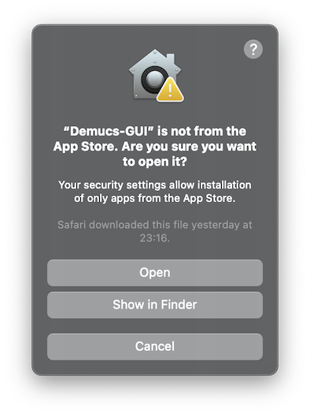
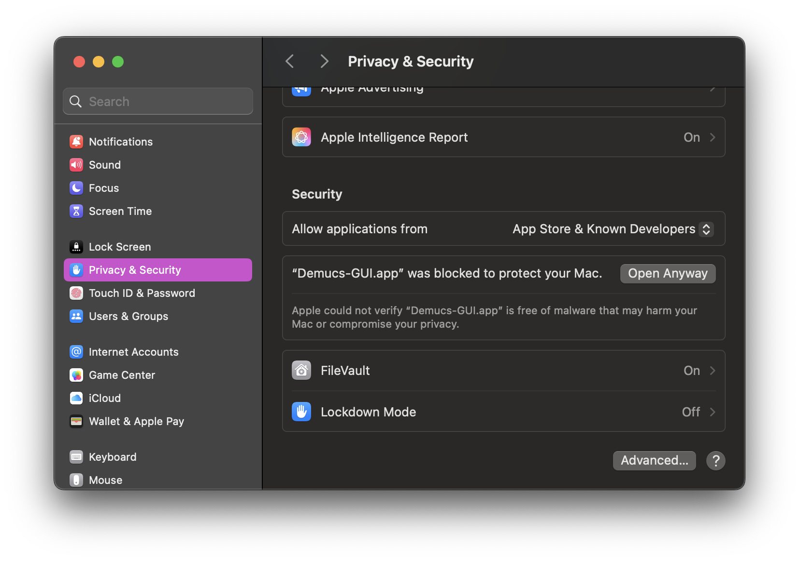

## [](.) Demucs GUI
[](https://github.com/CarlGao4/Demucs-Gui/releases) [](https://github.com/CarlGao4/Demucs-Gui/releases) [](LICENSE) [](https://github.com/CarlGao4/Demucs-Gui/releases) [](https://github.com/CarlGao4/Demucs-Gui/releases)

This is a GUI for music separation project `demucs`.

The project aims to let users without any coding experience separate tracks without difficulty. If you have any question about usage or the project, please open an issue to tell us. Since the original project [Demucs](https://github.com/adefossez/demucs) used scientific library `torch`, the packed binaries with environment is very large, and we will only pack binaries for formal releases.

### Donate to me

**If you like this project, please consider donating to me.**

[](https://paypal.me/CarlGao4) [paypal.me/CarlGao4](https://paypal.me/CarlGao4)

[](https://ko-fi.com/O5O11DZVGL) [ko-fi.com/O5O11DZVGL](https://ko-fi.com/O5O11DZVGL)

[](./donate_alipay.jpg) [AliPay QR Code](./donate_alipay.jpg)

<details id="CannotOpen">
  <summary>Note for macOS users</summary>

If the application cannot be launched due to the Mac's security protection feature, try the following:

For macOS versions below 15.0:

1. Right-click on the Demucs-GUI app icon and select "Open".
2. Click "Open" again in the window that appears as follows.



For macOS versions 15.0 or greater:
1. On your Mac, go to System Settings > Privacy & Security > Scroll to the Security section.
2. If you see a message stating "'Demucs-GUI.app' was blocked to protect your Mac." - to the right of this message, click "Open Anyway".
3. Enter your login password, then click OK. This will create an override in Gatekeeper, allowing Demucs-GUI to run.


</details>

## System requirements
### Installing binaries
#### System version
For Windows: At least Windows 8

For Mac: At least macOS 10.15

For Linux: Any system that can install and run python 3.11 (Because I'll pack the binaries using python 3.11). Requires at least glibc 2.27. If you are using xcb, you may need to install `libxcb-cursor0` (package name may vary on different distributions).

#### Hardware
Memory: About at least 8GB of total memory (physical and swap) would be required. The longer the track you want to separate, the more memory will be required.

GPU: Only NVIDIA GPUs (whose compute capability should be at least 3.5), Intel Arc & Iris Xe Graphics and Apple MPS are supported. At least 2GB of private memory is required.

### Running the codes yourself
At least Python 3.10 is required. Other requirements please refer to [Installing binaries](#installing-binaries).

## Downloads
Binaries for download are available on [GitHub Releases](https://github.com/CarlGao4/Demucs-Gui/releases) and [FossHub](https://www.fosshub.com/Demucs-GUI.html). Some files are too large to be uploaded to GitHub, so please refer to FossHub if you cannot find the file you need on GitHub.

## Update History

Please refer to [history.md](history.md).

## Usage
**If you are using released binaries, please refer to [usage.md](usage.md)**

*This part is written for those who want to run the codes themselves*

### FFmpeg support

FFmpeg is a supported audio reader of Demucs-GUI. Demucs-GUI will try to use FFmpeg as long as it is found in the `PATH` environment variable. Both FFmpeg and FFprobe are required. You can install it from source, use system package manager, download prebuilt binaries or use conda (recommended).

### CPU only on Windows or Apple MPS or CUDA on Linux
1. It is recommended to use the uv virtual environment to facilitate the deployment of the corresponding PyTorch Compute Platform.
2. Clone this repository and switch to this branch. You should run `git submodule update --init --recursive` since 1.1a2 version.
3. Use pip to install all packages in [requirements.txt](requirements.txt).

```bash
# For uv
uv pip install -r requirements.txt --torch-backend=auto
```
4. Run [`GuiMain.py`](GUI/GuiMain.py) and separate your song!


## Acknowledgements
This project includes code of [Demucs](https://github.com/adefossez/demucs) under MIT license.
